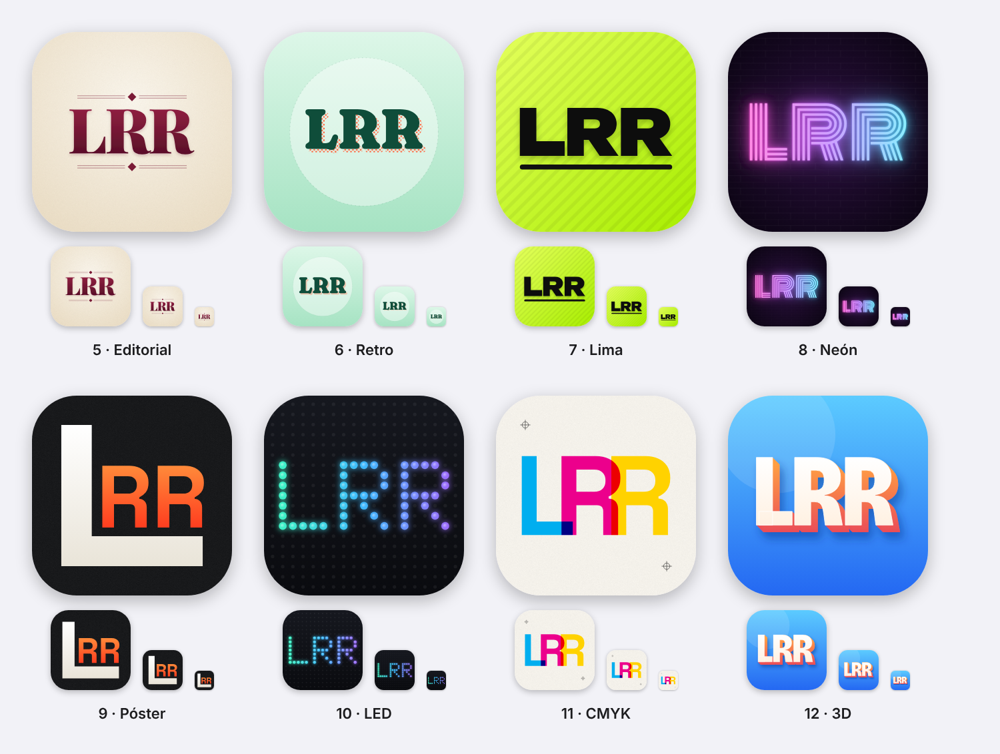
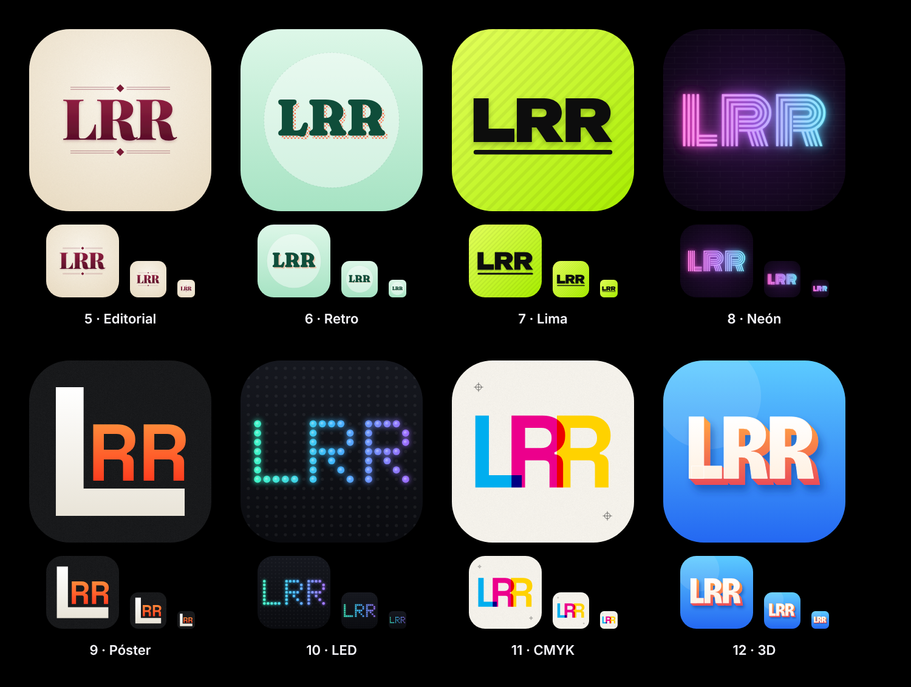
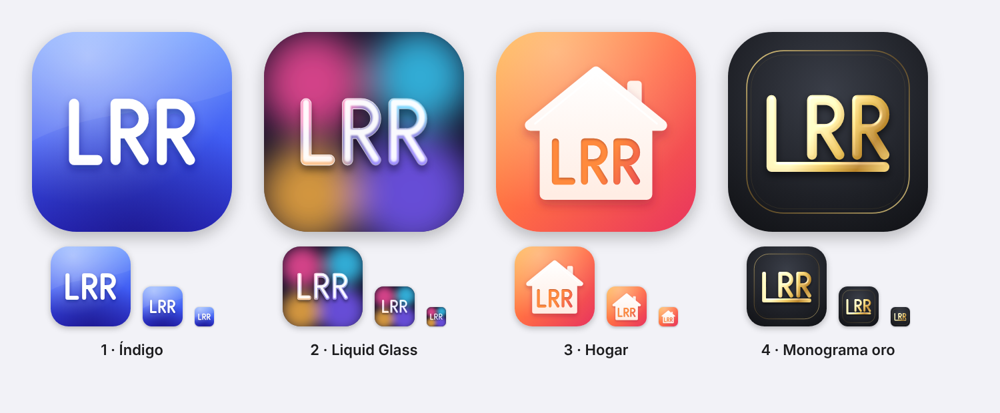
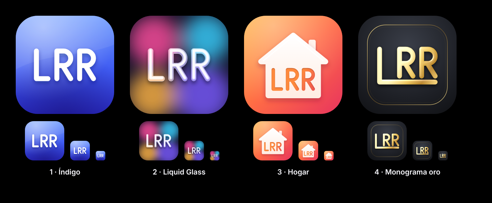

# Logo LRR · propuestas de icono

Propuestas de icono estilo iOS basadas en las siglas **LRR**.

## Ronda 2

| # | Archivo | Idea |
|---|---------|------|
| 5 | [`lrr-5-editorial.svg`](lrr-5-editorial.svg) | Serif de revista (Playfair Display Black) en burdeos sobre papel crema con textura, filetes dobles y rombos. |
| 6 | [`lrr-6-retro.svg`](lrr-6-retro.svg) | Serif suave y redondeada (Fraunces) en verde bosque, con un eco desplazado en trama de puntos coral, como una impresión retro. |
| 7 | [`lrr-7-lima.svg`](lrr-7-lima.svg) | Grotesca extendida muy gruesa (Unbounded) en negro sobre verde lima con rayas sutiles y barra inferior. |
| 8 | [`lrr-8-neon.svg`](lrr-8-neon.svg) | Letrero de neón multilínea (Monoton) con degradado rosa → violeta → cian y resplandor sobre pared de ladrillo oscura. |
| 9 | [`lrr-9-poster.svg`](lrr-9-poster.svg) | Monograma: una L gigante crema abraza las RR naranjas (Space Grotesk) sobre negro con grano. |
| 10 | [`lrr-10-led.svg`](lrr-10-led.svg) | Matriz de LEDs: LRR encendido en una rejilla de puntos, con degradado turquesa → violeta y brillo. |
| 11 | [`lrr-11-cmyk.svg`](lrr-11-cmyk.svg) | Letras superpuestas en cian, magenta y amarillo que se mezclan como tintas de imprenta, con marcas de registro. |
| 12 | [`lrr-12-3d.svg`](lrr-12-3d.svg) | Letras 3D extruidas (Bricolage Grotesque): cara blanca y lateral naranja-coral sobre azul cielo. |

## Ronda 1

| # | Archivo | Idea |
|---|---------|------|
| 1 | [`lrr-1-indigo.svg`](lrr-1-indigo.svg) | Clásico iOS: degradado azul-índigo, letras blancas redondeadas con sombra suave y brillo superior. |
| 2 | [`lrr-2-liquid-glass.svg`](lrr-2-liquid-glass.svg) | Estilo *Liquid Glass*: fondo de manchas de color desenfocadas y letras de vidrio esmerilado con borde y reflejo especular. |
| 3 | [`lrr-3-hogar.svg`](lrr-3-hogar.svg) | "Home": casa blanca con chimenea sobre degradado atardecer; LRR grabado en la fachada. |
| 4 | [`lrr-4-monograma-oro.svg`](lrr-4-monograma-oro.svg) | Monograma: la base de la L se extiende y abraza RR; oro biselado sobre grafito con marco fino. |

## Notas

- Lienzo de 1024 × 1024 a sangre completa, sin esquinas redondeadas: iOS
  aplica la máscara *squircle*. Las vistas previas la simulan.
- Las letras son contornos vectoriales (sin texto ni fuentes incrustadas), así
  que se ven igual en cualquier sistema. Las de la ronda 2 salen de fuentes
  con licencia SIL Open Font License (Google Fonts), que permite usarlas en
  logotipos.
- En [`png/`](png) hay exportaciones a 1024 px sin transparencia, listas para
  Xcode / App Store.
