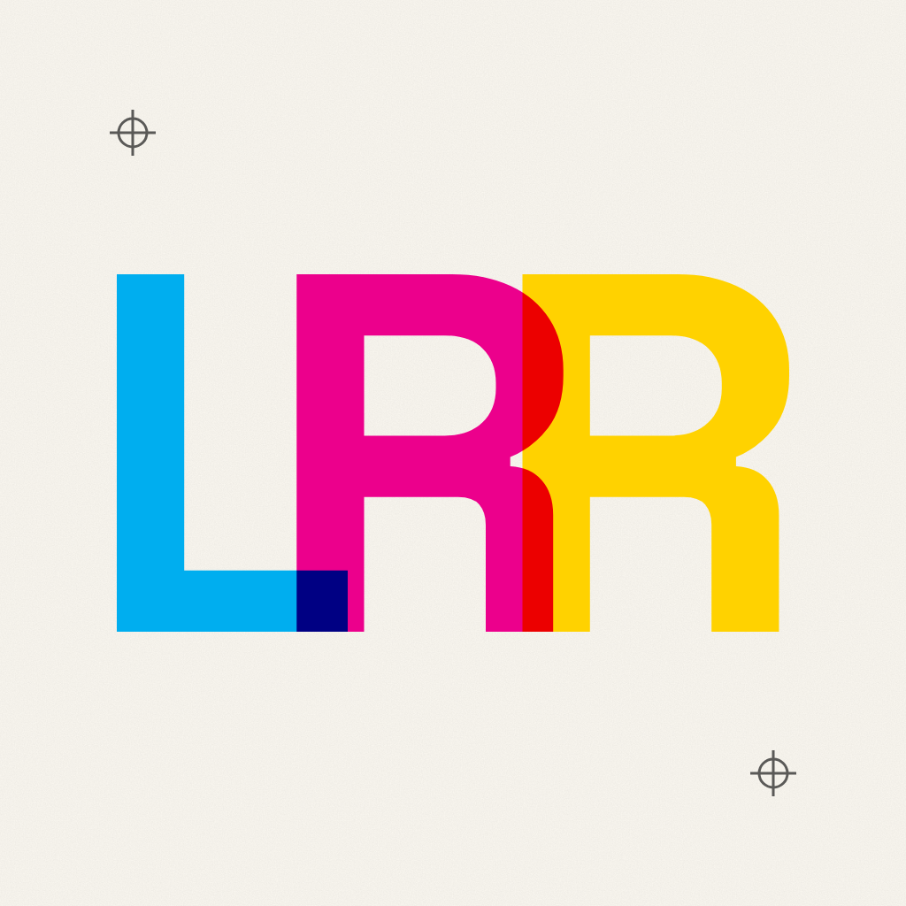

# Logo LRR

Icono estilo iOS: las letras **L**, **R** y **R** se superponen en cian,
magenta y amarillo y se mezclan como tintas de imprenta (CMYK), sobre papel
crema con marcas de registro.

- [`icon.svg`](icon.svg): fuente vectorial, 1024 × 1024 a sangre completa (iOS
  aplica la máscara *squircle*). Las letras son contornos de Space Grotesk
  (SIL Open Font License) convertidos a trazos.
- [`icon.png`](icon.png): exportación RGB opaca de 1024 px para Xcode / App Store.

El sitio lo usa como favicon y `apple-touch-icon` (`scripts/build.mjs` lo copia a `_site/`).
